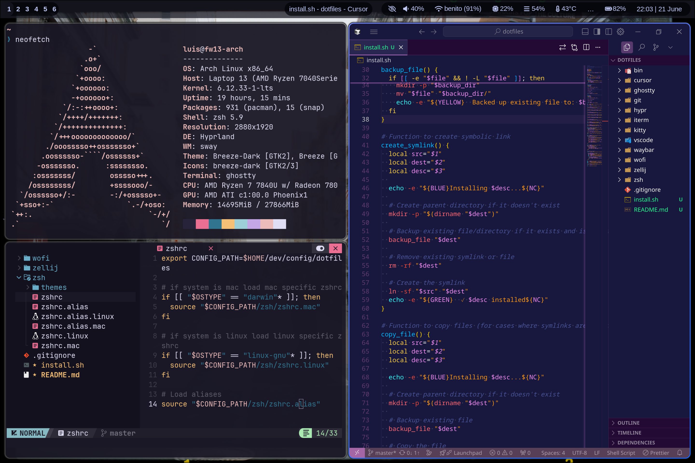

# 🐧 h4ch3 — Dotfiles (ThinkPad P53)



Archivos de configuración personales para Arch Linux en un Lenovo ThinkPad P53, con
**Sway** como gestor de ventanas y un tema que sale del propio fondo de pantalla gracias a
**Wallust**: cambias el fondo con `setwall` y la barra, Rofi, las notificaciones, la pantalla
de bloqueo y el borde de las ventanas se adaptan solos.

> [!WARNING]
> Usa estos scripts bajo tu propio riesgo. Revisa `install.sh` antes de ejecutarlo.
> Lo que ya exista en el destino y no sea un enlace se renombra a `*.bak`.

---

## ✨ Stack

| Componente | Herramienta |
|---|---|
| Gestor de ventanas | Sway (+ hyprlock e hypridle) |
| Terminal | Ghostty (paleta TokyoNight Moon; fondo, cursor y selección de Wallust) |
| Shell | Zsh modular + Oh My Zsh + Starship |
| Barra | Waybar (con scripts de VPN y *target*) |
| Lanzador y menús | Rofi (+ menús de `rofi/symphony`) |
| Notificaciones | swaync |
| Colores | Wallust (generados desde el fondo) |
| Otros | btop, zellij, cliphist, grim/slurp |

---

## 💻 Hardware objetivo (P53)

- **GPU**: híbrida Intel UHD 630 + Nvidia Quadro RTX 3000 (`nvidia-open` / `nvidia-open-lts`).
  Sway arranca con `sway/bin/sway-launch`: iGPU Intel como primaria y `--unsupported-gpu`.
- **CPU**: Intel Core i7-9850H
- **RAM**: 64 GB
- **Pantallas**: `eDP-1` (portátil) + `HDMI-A-1` (externo), ver `sway/config.d/10-outputs`

---

## 📦 Instalación

```bash
mkdir -p ~/dev/config
git clone https://github.com/h4ch3-h4ck/dotfiles.git ~/dev/config/dotfiles
cd ~/dev/config/dotfiles
./install.sh
```

`install.sh` permite instalar los paquetes (`pkglist.txt` y, con `yay`, `pkglist-aur.txt`),
Oh My Zsh y sus plugins, y crear los enlaces simbólicos en `~/.config` (incluida la config de
Sway mediante `sway/install-sway.sh`). Se puede ejecutar varias veces sin romper nada.

Después de instalar:

1. Crea `~/.zshrc.local` (`chmod 600`) a partir de `zsh/zshrc.local.example` con lo privado de
   tu máquina (IPs, usuarios, hosts). **Nunca** va al repo.
2. Elige un fondo: `setwall` (menú con las imágenes de `~/Imágenes/fondos`) o `setwall <imagen>`.

Para regenerar las listas de paquetes: `pacman -Qqen > pkglist.txt` y `pacman -Qqem > pkglist-aur.txt`.

---

## ⌨️ Atajos principales

`Super + H` muestra la guía completa, generada a partir de `sway/config.d/40-keybinds`.

| Atajo | Acción |
|---|---|
| `Super + Enter` | Terminal |
| `Super + Espacio` | Lanzador de aplicaciones |
| `Super + C` | Historial del portapapeles |
| `Super + X` | Menú de apagado |
| `Super + W` | Redes Wi-Fi |
| `Super + P` | Perfil de energía |
| `Super + M` | Música (radios / carpeta) |
| `Super + G` | Buscar en Google |
| `Super + L` | Bloquear pantalla |
| `ImprPant` / `Shift + ImprPant` / `Super + ImprPant` | Captura del monitor / de una zona / de la ventana |

---

## 🎨 Wallust — Colores desde el fondo

`setwall` (`sway/bin/setwall`) cambia el fondo, lo guarda en `sway/config.d/10-outputs`, ejecuta
`wallust run -s` y recarga Sway, Waybar y swaync. Las plantillas están en `wallust/templates/`:

| Plantilla | Genera | Lo usa |
|---|---|---|
| `colors-waybar.css` | `waybar/wallust/colors-waybar.css` | Waybar y swaync |
| `colors-rofi.rasi` | `rofi/wallust/colors-rofi.rasi` | Rofi |
| `colors-sway` | `sway/config.d/25-wallust` | Borde de la ventana activa |
| `colors-hyprlock.conf` | `hypr/hyprlock-wallust.conf` | Pantalla de bloqueo (y su fondo) |
| `colors-ghostty.conf` | `ghostty/wallust.conf` | Ghostty: solo fondo, cursor y selección |

En Ghostty la paleta ANSI sigue siendo la de TokyoNight Moon para que `ls`, git, etc. se lean
bien. Se usa siempre `-s` para no reescribir los colores de los terminales abiertos.

---

## 📂 Estructura

```
.
├── applications/  # .desktop que ocultan apps del lanzador
├── btop/          # Monitor de sistema
├── ghostty/       # Terminal
├── git/           # gitconfig global
├── hypr/          # hyprlock (pantalla de bloqueo) e hypridle
├── pacman/        # makepkg.conf
├── rofi/          # Lanzador, temas y menús (symphony/scripts)
├── starship/      # Prompt
├── sway/          # Sway: config.d/, bin/ (setwall, shot, sway-launch…), hypridle.conf
├── swaync/        # Notificaciones y centro de control
├── wallust/       # Config y plantillas de Wallust
├── waybar/        # Barra (config-sway, modules-sway.json, scripts)
├── zellij/        # Multiplexor de terminal
├── zsh/           # zshrc, alias y plantilla de ~/.zshrc.local
├── install.sh     # Instalador (paquetes + enlaces)
├── pkglist.txt    # Paquetes de los repositorios
└── pkglist-aur.txt # Paquetes de AUR
```

---

## 🙏 Créditos

Empezó como fork de la plantilla de [luismendozamx](https://github.com/luismendozamx),
evolucionado para adaptarse al hardware P53 y mi flujo de trabajo personal.

---

## 📄 Licencia

MIT — copia, modifica y comparte libremente.
